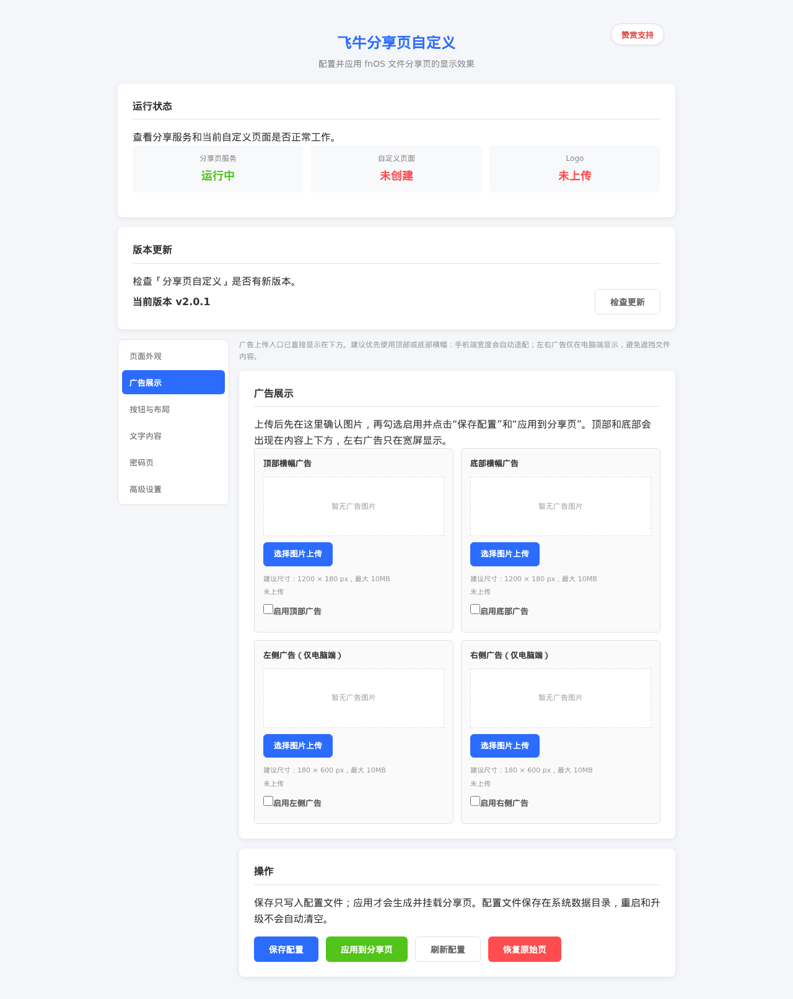
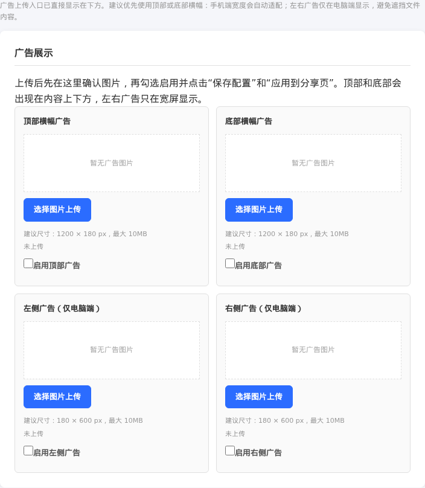
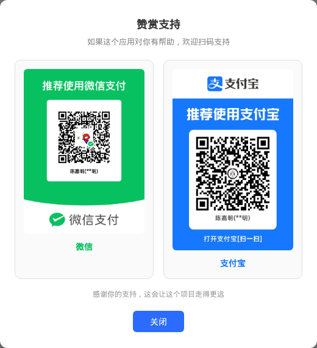

# fnOS 分享页自定义

用于自定义飞牛 fnOS 文件分享页面的第三方 FPK 应用。通过可视化界面调整分享页、密码访问页和错误提示页的外观，并可随时恢复当前 fnOS 原始分享页面。



## 主要功能

- 自定义分享页与密码页 Logo、背景、文字和主题色
- 调整下载、转存按钮的样式、顺序、宽度和显示状态
- 配置顶部、底部横幅及桌面端左右侧栏广告
- 自定义无效链接、访问次数超限、链接过期和文件不存在提示
- 导入、导出 JSON 配置，并提供配色预设
- 多更新源自动检查新版本：三台更新服务器并行探测，GitHub Releases 兜底，带更新弹窗
- 内置微信、支付宝赞赏入口
- 应用配置持久保存，支持恢复原始分享页和卸载清理

| 广告配置 | 赞赏入口 |
| --- | --- |
|  |  |

## 安装与运行

### fnOS 安装

1. 从 [GitHub Releases](https://github.com/cjm2004/fnos-share-customizer/releases) 下载最新的 `fnos-share-customizer.fpk`。
2. 进入 fnOS 应用中心，选择手动安装。
3. 安装完成后打开「分享页自定义」。
4. 保存配置，再点击「应用到分享页」。

应用默认监听 `38080` 端口，最低支持 fnOS `0.8.42`。

### 从源码构建

安装官方 [fnpack](https://developer.fnnas.com/docs/cli/fnpack/) 后，在仓库根目录执行：

```bash
fnpack build --directory source
```

构建完成后，安装包会生成在仓库根目录。

## 使用说明

- **保存配置**：仅保存表单内容，不修改正在运行的分享页。
- **应用到分享页**：根据当前 fnOS 原始页面重新生成并挂载自定义页面。
- **恢复原始页**：解除挂载，恢复当前系统自带的分享页面；已保存的配置和图片仍会保留。
- **上传图片**：支持 PNG、JPEG、GIF、WebP；Logo 最大 5 MB，背景与广告图片最大 10 MB。
- **广告建议尺寸**：横幅 `1200 × 180 px`，侧栏 `180 × 600 px`；手机端自动隐藏侧栏广告。

## 工作原理

应用将配置和上传图片保存在 `/usr/local/share/fnos-custom`。应用自定义设置时，会读取当前 fnOS 分享页、注入样式与前端增强脚本，并通过 bind mount 接管页面文件。

启动、升级或系统重启后，应用会先校验当前系统入口引用的 JavaScript/CSS 是否完整，再重新生成并挂载页面。校验失败时保持原始页面，避免 fnOS 升级后因旧资源失效造成分享页空白。

## 注意事项

- fnOS 系统升级可能调整分享页 DOM 结构，升级后请检查自定义效果。
- 安装包版本不能低于设备上已安装的版本；当前版本为 `2.0.1`。
- 不要手动删除 `/usr/local/share/fnos-custom`，否则可能丢失配置和图片。
- 本应用需要 root 权限操作分享模块和 systemd bind mount。
- 更新检查会并行探测三台更新服务器并检查 GitHub 最新版本；网络不可用不会影响主要功能。

## 开发与测试

项目包含 pytest 与 Playwright 测试，覆盖配置接口、页面注入、生命周期、挂载回滚和真实 fnOS 前端兼容性。安装测试依赖后执行：

```bash
pytest -q
```

## 开发者

- 开发者及发布者：无名的小卒
- GitHub：<https://github.com/cjm2004/fnos-share-customizer>

## 许可

本项目当前未声明开源许可证。未经明确许可，不代表授予复制、修改或再发布代码的权利。
